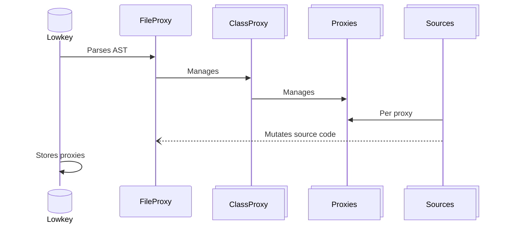

<a href="https://rubygems.org/gems/lowkey" title="Install gem"></a> <a href="https://github.com/low-rb/lowkey" title="GitHub"></a> <a href="https://codeberg.org/Iow/key" title="Codeberg"></a>

# Lowkey

Prism is amazing and opens up new ways to access metadata in Ruby. However:
- Loading the Abstract Syntax Tree (AST) multiple times is inefficient
- We need higher level abstractions such as classes and methods
- Navigating the AST can be difficult

Lowkey provides a central API for storing this metadata once and accessing it multiple times. It's the secret sauce 🌶️ behind [LowType](https://github.com/low-rb/lowtype), [Dirload](https://github.com/low-rb/dirload) and [Raindeer](https://github.com/raindeer-rb/raindeer) in general.

## Usage

```ruby
Lowkey['my_class.rb'] # => FileProxy
Lowkey['my_class.rb']['MyNamespace::MyClass'] # => ClassProxy
```

The first key is either an absolute path or path relative to the starting Ruby process.

## Proxies

Proxies provide a "flat" abstraction over the Abstract Syntax Tree.

**Proxy Types:**
- `FileProxy` - The file path, its definitions and dependencies
- `ClassProxy` - The class and its methods
- `MethodProxy` - A method and its parameters
- `ParamProxy` - A parameter and its type
- `ReturnProxy` - The return type of the method

### Method access

```ruby
Lowkey['my_class.rb']['MyNamespace::MyClass'][:my_method] # => MethodProxy
```

ℹ️ For more information on proxies see the [Proxy API](#proxy).

## Queries

Queries access nested nodes within the AST via keypath syntax:
```ruby
Lowkey['my_class.rb::MyNamespace::MyClass.my_method'] # => MethodDefNode
```

A query can start at any proxy and still use the keypath syntax:
```ruby
# Query from a file proxy.
file_proxy = Lowkey['my_class.rb']
file_proxy['MyNamespace::MyClass.my_method'] # => MethodDefNode

# Query from a class proxy.
class_proxy = Lowkey['my_class.rb']['MyNamespace::MyClass']
class_proxy['.my_method'] # => MethodDefNode
```

ℹ️ Query keypaths contain dots "`.`" and return nodes. They target the `name` attribute of nodes.

### Value Parsing

`Lowkey::ValueParser` reads Ruby values like `nil`, `true`, `'text'`, `3`, `-1.5` or `:symbol` from text or Prism nodes, without evaluating dangerous code. If the code is not a value then it will yield a block:

```ruby
Lowkey::ValueParser.parse("'it\\'s'") { nil } # => "it's"
Lowkey::ValueParser.parse('page.title') { |text| fallback(text) } # => fallback's result

Lowkey::ValueParser.value?(node) # => true for a value node
Lowkey::ValueParser.value(node) { raise 'Not a value' }
```

## Mutations

You can mutate a file using either Proxies or Queries:

|             | **Difficulty** | **Structure** | **Mutations**                                          |
|-------------|----------------|---------------|--------------------------------------------------------|
| **Proxies** | Easy           | Flat          | Preserves existing code and line numbers when possible |
| **Queries** | Medium         | Nested        | Generates new code from the Abstract Syntax Tree       |

ℹ️ Both approaches can be mixed together, for example; using queries to get data for a proxy.

### Proxy Mutations

Replacing a method's source code:
```ruby
Lowkey['my_class.rb']['MyNamespace::MyClass'][:my_method].source_code = my_string_of_code
```

### Query Mutations [UNRELEASED]

Using the query keypath we can manipulate the AST:
```ruby
Lowkey['my_class.rb::MyNamespace::MyClass.my_method'] = my_node
```

## Exports

### Proxy Exports

Export the source code for mutated proxies to memory:
```ruby
Lowkey['my_class.rb'].export
Lowkey['my_class.rb']['MyNamespace::MyClass'].export
Lowkey['my_class.rb']['MyNamespace::MyClass'][:my_method].export
```

Save the source code for mutated proxies to disk: [UNRELEASED]
```ruby
Lowkey['my_class.rb'].save(file_path:) # Replaces entire file.
Lowkey['my_class.rb']['MyNamespace::MyClass'].save(file_path:) # Replaces part of a file.
Lowkey['my_class.rb']['MyNamespace::MyClass'][:my_method].save(file_path:) # Replaces part of a file.
```

### Query Exports [UNRELEASED]

Export generated code for mutated nodes to memory: [UNRELEASED]
```ruby
Lowkey['my_class.rb.root_node'].export # Special selector for the top level node.
Lowkey['my_class.rb::MyNamespace::MyClass.root_node'].export
Lowkey['my_class.rb::MyNamespace::MyClass.my_method'].export
```

Save generated code for mutated nodes to disk: [UNRELEASED]
```ruby
Lowkey['my_class.rb.root_node'].save(file_path:) # Replaces entire file.
Lowkey['my_class.rb::MyNamespace::MyClass'].save(file_path:) # Replaces entire file.
Lowkey['my_class.rb::MyNamespace::MyClass.my_method'].save(file_path:) # Replaces entire file.
```

ℹ️ Code is generated from the AST and will not match the source code that was originally loaded.

## Config

Copy and paste the following and change the defaults to configure Lowkey:

```ruby
# This configuration should be set before calling "Lowkey.load".
Lowkey.configure do |config|
  # A big benefit of Lowkey is its caching of abstract syntax trees, file proxies and class proxies.
  # But to save memory you should clear them after the "class load"/setup stage of your application.
  # Set to "false" or call "Lowkey.clear" after you no longer need Lowkey, such as in a boot script.
  # References to particular proxies will still keep them in memory or call Lowkey.keep(file_proxy).
  config.cache = true

  # Prism nodes use most of a cached file's memory, so they're released once a file loads.
  # However you may be doing advanced AST manipulation like reading method calls or querying nodes.
  # Set to "false" to keep AST nodes or keep per file: Lowkey.load(file_path, release_nodes: false).
  config.release_nodes = true
end
```

## Architecture



## API

### Lowkey

**Methods:**
- `load(file_path)` - Use an absolute file path for best results. Relative paths are generated automatically in addition. Returns `FileProxy`

### Proxy

**Methods:**
- `wrap(prefix:, suffix:)` - Wrap the code inside the prefix and suffix. Handles indentation and line breaks.
- `export` - Export the modified source code to string

### MethodProxy

**Properties:**
- `params` - Array of `ParamProxy`s
- `body` - The method's body `BodyProxy`
- `return_proxy` - The method's return type `ReturnProxy`

## Installation

Add `gem 'lowkey'` to your Gemfile then:
```
bundle install
```

## Performance

An app with 500 LowType files would spend about 0.25s of boot in lowkey.
